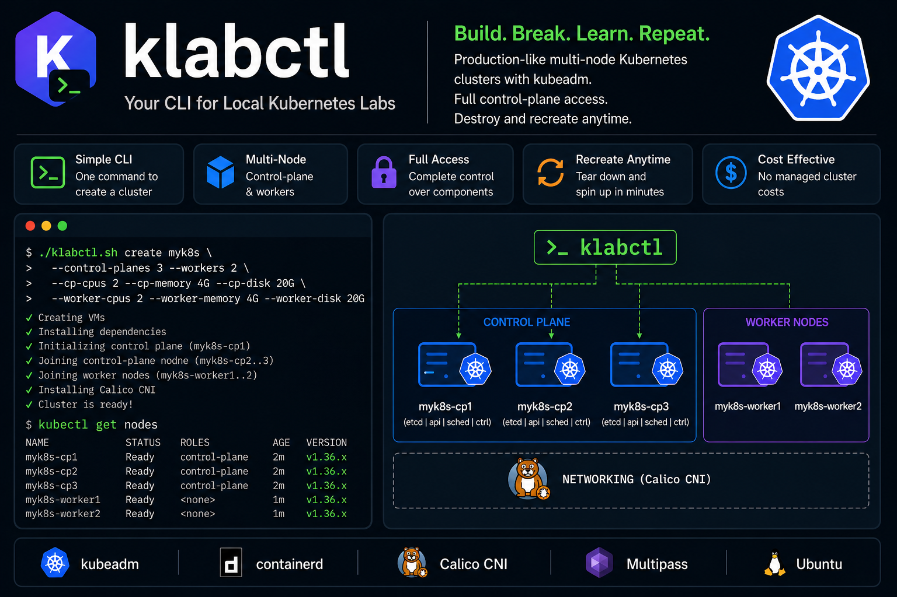

# klabctl

Production-like multi-node Kubernetes cluster on Multipass using kubeadm. Full control-plane access for learning, debugging, and experimentation without managed cluster cost.



Site: [klabctl.skalekontrol.com](https://klabctl.skalekontrol.com/)

Project CLI: `./klabctl.sh`

Current release: [v0.1.0](https://github.com/SkaleKontrol/klabctl/releases/tag/v0.1.0). `./klabctl.sh version` prints the version of the checkout. Maintainers cut releases with [RELEASING.md](RELEASING.md).

## Why klabctl?

There are already great local Kubernetes tools like Minikube, kind, k3d, MicroK8s, and Rancher Desktop.

`klabctl` is for a different use case: a production-like kubeadm lab on local VMs with full node-level access.

Use `klabctl` when you want to:

- Practice kubeadm-style cluster operations on separate control-plane and worker nodes
- Prepare for certification-level hands-on scenarios (for example CKA/CKS-style troubleshooting and ops tasks)
- Study and validate observability stacks (Prometheus/Grafana/Loki/OTel, etc.) in a production-like multi-node lab
- Debug real node/network/runtime issues (containerd, CNI, kubelet, certs, join flows)
- Simulate multi-node and HA topologies (`1cp/1worker`, `3cp/2worker`, etc.)
- Keep full VM-level control (shell access, restart nodes, inspect OS/systemd/network state)

If you only need a lightweight local cluster for app dev testing, kind/k3d/Minikube can be faster.  
If you need deeper, production-like cluster behavior and troubleshooting practice, `klabctl` fits better.

## Prerequisites

- A host that can run Multipass with KVM:
  - Ubuntu 24.04 or newer
  - Debian, Linux Mint, Pop!_OS, or another Linux with the same virtualization support
- KVM enabled
- `kubectl` installed on host (required for host-side commands like `kubectl get nodes`)
  - Install docs: [Install and Set Up kubectl on Linux](https://kubernetes.io/docs/tasks/tools/install-kubectl-linux/)
- Default baseline (recommended starting point):
  - ~4 vCPU
  - ~10-12 GB RAM free
  - ~20 GB disk minimum (40 GB preferred)
  - Typical per-node sizing: `2 CPU / 4G RAM / 10G disk` for both control-plane and worker nodes
  - Default create profile: `--control-planes 1 --workers 1`
- Recommended for stable HA/workloads (with per-node sizing):
  - ~8+ vCPU
  - ~16+ GB RAM free
  - ~100 GB disk
  - Typical per-node sizing: `2 CPU / 4G RAM / 20G disk` for both control-plane and worker nodes
  - Recommended create profile: `--control-planes 3 --workers 2` (and increase per-node resources as needed)

References:
- [Multipass Requirements](https://documentation.ubuntu.com/multipass/latest/explanation/requirements/)
- [How to check KVM support (Ubuntu docs)](https://help.ubuntu.com/community/KVM/Installation)

## Kubernetes version

`create` installs the same Kubernetes release on every node (`kubelet`, `kubeadm`, and `kubectl`).

| Setting | Value |
|---|---|
| Default | `1.36` (newest patch in the 1.36 package repository) |
| Targeted minors | `1.35`, `1.36`, `1.37` |

These match the Kubernetes releases that still receive upstream patches. Current status is on the [Kubernetes releases](https://kubernetes.io/releases/) page.

```bash
# Newest patch of a minor. Default is 1.36.
./klabctl.sh create <cluster-name> --k8s-version 1.35

# Pin a patch. A leading v is optional (1.36.5 and v1.36.5 are the same).
./klabctl.sh create <cluster-name> --k8s-version 1.36.5
./klabctl.sh create <cluster-name> --k8s-version v1.37.1
```

- A minor such as `1.35` uses the [`pkgs.k8s.io`](https://kubernetes.io/docs/setup/production-environment/tools/kubeadm/install-kubeadm/) stable repository for that minor and installs the newest `kubelet`, `kubeadm`, and `kubectl` packages in it.
- A patch such as `1.36.5` installs packages matching `1.36.5-*` and holds them with `apt-mark hold`.
- The version is chosen at create time. To run a different release, create another cluster, or delete this one and create it again with a new `--k8s-version`.
- Other `1.y` minors use the same flag. `klabctl` prints a warning when the minor is outside `1.35`–`1.37`, then continues if that minor still has a published stable repository.

Host `kubectl` talks to the API server on your machine. Install a host `kubectl` within one minor of the cluster version ([version skew policy](https://kubernetes.io/releases/version-skew-policy/)). For a `1.36` cluster, host `kubectl` `1.35`, `1.36`, or `1.37` is in range. Matching the cluster minor (`1.36.x`) is the closest fit.

## Install klabctl

Ubuntu 24.04 or newer, and Ubuntu-based systems such as Linux Mint and Pop!_OS. Install Multipass first. KVM has to be enabled. The [Multipass installation guide](https://documentation.ubuntu.com/multipass/latest/how-to-guides/install-multipass/) has the current steps.

```bash
sudo snap install multipass

sudo add-apt-repository --yes ppa:skalekontrol/klabctl
sudo apt update
sudo apt install klabctl
```

Install [kubectl on the host](https://kubernetes.io/docs/tasks/tools/install-kubectl-linux/) before `kubectl get nodes`. For the default 1.36 cluster, host kubectl 1.35, 1.36, or 1.37 is in range.

On a Linux host that does not use this PPA, use the git checkout in the next section and run `./klabctl.sh`.

## Quick Start

### Step 0: Clone this repository

`main` tracks current development. A tag such as `v0.1.0` is a fixed release. Published versions are on the [GitHub Releases](https://github.com/SkaleKontrol/klabctl/releases) page.

```bash
git clone https://github.com/SkaleKontrol/klabctl.git
cd klabctl

# Stay on main, or pin a release:
git checkout v0.1.0

./klabctl.sh version
```

### Step 1: Install Multipass (requires sudo, run manually)

```bash
sudo snap install multipass
```

Official install docs (recommended to verify latest instructions):
- [Multipass Installation Guide](https://documentation.ubuntu.com/multipass/latest/how-to-guides/install-multipass/)

Verify:

```bash
multipass version
```

### Step 2: Create VMs and bootstrap cluster

```bash
# Make script executable
chmod +x klabctl.sh

# Create default cluster "k8s"
./klabctl.sh create k8s

# Or create a custom cluster (VM names start with this prefix)
./klabctl.sh create <cluster-name>

# Minimum node counts
./klabctl.sh create <cluster-name> --control-planes 1 --workers 1

# Newest patch of Kubernetes 1.35 (default is 1.36)
./klabctl.sh create <cluster-name> --k8s-version 1.35

# Pin patch 1.36.5 on every node
./klabctl.sh create <cluster-name> --k8s-version 1.36.5

# Default baseline profile (matches prerequisites above)
./klabctl.sh create <cluster-name> \
  --control-planes 1 --workers 1 \
  --cp-cpus 2 --cp-memory 4G --cp-disk 10G \
  --worker-cpus 2 --worker-memory 4G --worker-disk 10G

# Recommended HA/workload profile (values below are per node, not cluster totals)
./klabctl.sh create <cluster-name> \
  --control-planes 3 --workers 2 \
  --cp-cpus 2 --cp-memory 4G --cp-disk 20G \
  --worker-cpus 2 --worker-memory 4G --worker-disk 20G
```

`klabctl.sh create` prints estimated total vCPU/RAM for the requested node counts and asks for confirmation before creating VMs.
Control-plane and worker per-node resources can be increased at create time using `--cp-*` and `--worker-*` flags.
The default Kubernetes version is `1.36`. Pass `--k8s-version` to select another minor or patch. See [Kubernetes version](#kubernetes-version).

### Create Options

`cp` means **control-plane**.

- `--control-planes N`: number of control-plane nodes (min: `1`)
- `--workers N`: number of worker nodes (min: `1`)
- `--k8s-version VERSION`: Kubernetes minor (`1.36`, `v1.36`) or patch (`1.36.5`, `v1.36.5`). Default: `1.36` (newest patch). Targeted minors: `1.35`, `1.36`, `1.37`
- `--cp-cpus N`: vCPUs per control-plane node (min: `2`)
- `--cp-memory SIZE`: RAM per control-plane node (min: `1700M`, examples: `4G`, `4096MB`)
- `--cp-disk SIZE`: disk per control-plane node (example: `10G`, `30G`)
- `--worker-cpus N`: vCPUs per worker node (min: `1`)
- `--worker-memory SIZE`: RAM per worker node (min: `1700M`, examples: `4G`, `4096MB`)
- `--worker-disk SIZE`: disk per worker node (example: `10G`, `30G`)

### Cluster Management CLI

```bash
# List clusters created via klabctl naming convention
./klabctl.sh list

# Create a specific cluster
./klabctl.sh create <cluster-name> --control-planes 3 --workers 2

# Start / stop a specific cluster
./klabctl.sh start <cluster-name>
./klabctl.sh stop <cluster-name>
./klabctl.sh refresh <cluster-name>

# Delete one specific cluster
./klabctl.sh delete <cluster-name>

# Non-interactive delete + purge deleted instances
./klabctl.sh delete <cluster-name> --yes --purge
```

`delete` also removes that cluster's context/cluster/user entries from `~/.kube/config` (if present).

`klabctl.sh create` will:

1. Create VMs with prefix `<cluster-name>`:
   `<cluster-name>-cp1..N` and `<cluster-name>-worker1..N`
2. Install containerd, kubeadm, kubelet, kubectl on all nodes
3. Initialize the control plane on `<cluster-name>-cp1`
4. Join additional control-plane nodes (`<cluster-name>-cp2..N`)
5. Join worker nodes (`<cluster-name>-worker1..N`)
6. Install Calico CNI
7. Generate `kubeconfig-<cluster-name>.yaml` for host access

By default, cluster creation parallelizes package installation and node joins (after `<cluster-name>-cp1` is initialized); VM launch is intentionally sequential for stability.

### Step 3: Use the cluster

```bash
# After a successful create, klabctl already:
# 1) creates kubeconfig-<cluster-name>.yaml
# 2) merges it into ~/.kube/config
# 3) switches current context to <cluster-name>

kubectl get nodes

# Open shell to default control-plane node (<cluster-name>-cp1)
./klabctl.sh shell <cluster-name>

# Open shell to a specific non-default node
./klabctl.sh shell <cluster-name> <cluster-name>-worker1
```

## Manual Steps (if cluster create fails)

Manual setup guide is not added yet. Prefer re-running `./klabctl.sh create <cluster-name>` after fixing the failing step.

## Default VM Specs

| Node Pattern             | Role          | RAM  | CPU | Disk  |
|--------------------------|---------------|------|-----|-------|
| `<cluster>-cp1..N`       | control-plane | 4G | 2 | 10G |
| `<cluster>-worker1..N`   | worker        | 4G | 2 | 10G |

Node counts are user-defined via `--control-planes` and `--workers` (minimum `1` each).
You can increase per-node sizing with `--cp-cpus`, `--cp-memory`, `--cp-disk`, `--worker-cpus`, `--worker-memory`, and `--worker-disk`.

## Useful Commands

```bash
# List VMs (all clusters)
./klabctl.sh nodes

# List VMs for one cluster only
./klabctl.sh nodes <cluster-name>

# Shell into a node (defaults to ${CLUSTER_NAME}-cp1)
./klabctl.sh shell <cluster-name>

# Shell into a specific node
./klabctl.sh shell <cluster-name> <cluster-name>-worker1

# Delete cluster (destructive; removes all cp/worker nodes for this cluster)
./klabctl.sh delete <cluster-name> --yes --purge

# Refresh kubeconfig and hosts after VM restart (IPs may change)
./klabctl.sh refresh <cluster-name>
```

